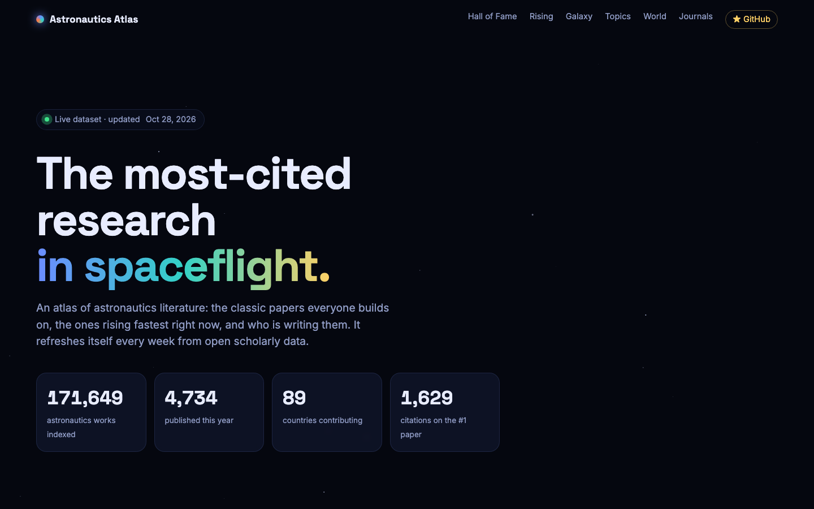

<div align="center">

# 🛰️ Astronautics Atlas

**The most-cited research in spaceflight, tracked automatically every week.**

[](https://pars519-tur.github.io/astronautics-atlas/)
[](https://github.com/pars519-Tur/astronautics-atlas/actions)
[](https://openalex.org)
[](LICENSE)

[**Open the atlas →**](https://pars519-tur.github.io/astronautics-atlas/)



</div>

## What's inside

| | |
|---|---|
| 🏆 **Hall of Fame** | The 100 most-cited astronautics works ever, searchable and filterable by field and era (Space Race, Shuttle, ISS, NewSpace) |
| 🚀 **Rising Stars** | Papers from the last 6 years ranked by citations gained this year and last |
| 🌌 **Citation Galaxy** | Every highlighted paper plotted by year and citations; click a star to open it |
| 📈 **The Landscape** | Publications per year for each field since Sputnik (1957) |
| 🌍 **World map** | Which countries publish astronautics research, all-time vs. the last 4 years |
| 📚 **Journals & institutions** | Where the field publishes and who publishes the most |

Each paper opens a detail card with its citation history, influential-citation count, FWCI, and links to the DOI, free full text, Semantic Scholar and Google Scholar.

## 🔭 Live Top 10

<!-- TOP10:START -->
| # | Paper | Year | Citations |
|---:|---|:---:|---:|
| 1 | [Survey of Numerical Methods for Trajectory Optimization](https://doi.org/10.2514/2.4231) <br><sub>John T. Betts</sub> | 1998 | 2,605 |
| 2 | [Terminal Guidance System for Satellite Rendezvous](https://doi.org/10.2514/8.8704) <br><sub>W. H. Clohessy et al.</sub> | 1960 | 2,093 |
| 3 | [Spacecraft Attitude Determination and Control](https://doi.org/10.1007/978-94-009-9907-7) <br><sub>James R. Wertz</sub> | 1978 | 1,892 |
| 4 | [Rocket Propulsion Elements](https://doi.org/10.1063/1.3066790) <br><sub>George P. Sutton et al.</sub> | 1950 | 1,761 |
| 5 | [An introduction to the mathematics and methods of astrodynamics](https://openalex.org/W1511057778) <br><sub>Richard H. Battin</sub> | 1987 | 1,737 |
| 6 | [Analytical Mechanics Of Space Systems](https://doi.org/10.2514/4.861550) <br><sub>Hanspeter Schaub et al.</sub> | 2003 | 1,578 |
| 7 | [The evolution of orbits of artificial satellites of planets under the action of gravitational perturbations of external bodies](https://doi.org/10.1016/0032-0633(62)90129-0) <br><sub>M. L. Lidov</sub> | 1962 | 1,570 |
| 8 | [Spacecraft Attitude Dynamics](https://openalex.org/W1499655155) <br><sub>Peter C. Hughes</sub> | 1986 | 1,566 |
| 9 | [Satellite Communications in the New Space Era: A Survey and Future Challenges](https://doi.org/10.1109/comst.2020.3028247) <br><sub>Oltjon Kodheli et al.</sub> | 2020 | 1,555 |
| 10 | [Fundamentals of Astrodynamics and Applications](https://openalex.org/W1666375428) <br><sub>David Vallado</sub> | 1997 | 1,537 |

<sub>Auto-updated 2026-10-28 · 274,425 astronautics works indexed</sub>
<!-- TOP10:END -->

## Fields covered

Astrodynamics & GNC · Spacecraft & SmallSats · Rocket Propulsion · Space Debris & Robotics · Satellite Communications · Cryogenics & Propellants · Human Spaceflight · Space Life Sciences

Each field maps to an [OpenAlex topic](https://docs.openalex.org/api-entities/topics). The mapping lives in `TOPICS` in [`scripts/fetch_data.py`](scripts/fetch_data.py).

## How it works

```
 every Monday            GitHub Action                         GitHub Pages
 ───────────▶  scripts/fetch_data.py ──▶ data/dataset.json ──▶  index.html + ECharts
               (OpenAlex + Semantic Scholar)  data/history.json
```

- **No server, no database, no cost.** A scheduled workflow fetches fresh data, commits it, and redeploys the static site.
- **Zero dependencies.** The fetcher uses only the Python standard library.
- **History builds up over time.** Each run appends a snapshot to `data/history.json`, so citation growth can be charted week by week.

### Metrics

| Metric | Meaning |
|---|---|
| Citations | Total times cited (OpenAlex) |
| Momentum | Citations received this calendar year plus last year |
| Citations / year | Total citations divided by years since publication |
| Influential | Citations where the paper meaningfully shaped the citing work ([Semantic Scholar](https://www.semanticscholar.org/faq#influential-citations)) |
| FWCI | Field-weighted citation impact; 1.0 is the world average for similar papers |

> Most aerospace publishers don't openly publish download or read counts, so momentum and influential citations stand in for "demand".

## Run it locally

```bash
git clone https://github.com/pars519-Tur/astronautics-atlas.git
cd astronautics-atlas
python3 scripts/fetch_data.py      # optional: refresh the data
python3 -m http.server 8000        # open http://localhost:8000
```

OpenAlex gives every IP a small free daily budget, and a weekly run uses a tiny fraction of it. For a dedicated budget, get a free key at [openalex.org/settings/api](https://openalex.org/settings/api) and add it as the `OPENALEX_API_KEY` repository secret.

## Contributing

Ideas, new fields, and better visualizations are all welcome.

- **Bad record?** OpenAlex occasionally misattributes citations. Add the work ID to [`scripts/blocklist.txt`](scripts/blocklist.txt) and open a PR.
- **Missing field?** Propose an OpenAlex topic ID for `TOPICS` in an issue.

If the atlas helps your research, a ⭐ helps others find it.

## Acknowledgements

Data from [OpenAlex](https://openalex.org) (CC0) and the [Semantic Scholar API](https://www.semanticscholar.org/product/api). Charts by [Apache ECharts](https://echarts.apache.org).
